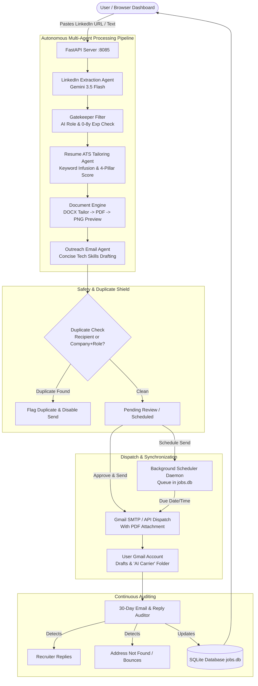

# 🚀 JobFlow AI – Autonomous Multi-Agent Job Application & ATS Pipeline

**JobFlow AI** is an intelligent, autonomous multi-agent platform that streamlines the technical job search lifecycle. It ingests LinkedIn job postings, validates candidate eligibility via an AI Gatekeeper, tailors resumes with surgical ATS keyword alignment, drafts concise technical outreach emails, syncs drafts directly to Gmail, enforces a strict anti-duplicate outreach shield, and monitors recruiter replies and delivery bounces.

---

## 📌 Table of Contents
- [What This Project Does](#-what-this-project-does)
- [Why It Is Useful](#-why-it-is-useful)
- [System Architecture](#-system-architecture)
- [Core Agents & Modules](#-core-agents--modules)
- [End-to-End Workflow](#-end-to-end-workflow)
- [Key Features](#-key-features)
- [Tech Stack](#-tech-stack)
- [Getting Started](#-getting-started)
- [Configuration & Environment Variables](#-configuration--environment-variables)

---

## 💡 What This Project Does

Searching and applying for high-level technical roles is time-consuming, prone to generic messaging, and vulnerable to ATS keyword filtering. **JobFlow AI** replaces manual overhead with a team of specialized AI agents:

1. **LinkedIn Post Ingestion:** Extracts recruiter information, required experience, core technical stack, and detailed job deliverables directly from LinkedIn URLs or raw text.
2. **AI Gatekeeper & Compatibility Filter:** Automatically assesses whether the job is an AI-focused role (Generative AI, LLMs, NLP, ML, LangChain, etc.) and falls within the candidate's target experience range (0–8 years for a 5.5-year experienced candidate), calculating an exact Compatibility Score.
3. **ATS 4-Pillar Resume Tailoring:** Surgically aligns the candidate's base DOCX resume with the job description by infusing top missing keywords into Skills & Professional Summary, produces an ATS-compliant PDF, generates high-resolution visual previews, and calculates an honest ATS score.
4. **Tailored Outreach Generation:** Drafts concise, professional corporate outreach emails (strictly 3 paragraphs, under 30 words per paragraph) highlighting verified technical skills matching the job description, plus ready-to-send LinkedIn InMails/DMs.
5. **Duplicate Prevention Shield:** Enforces a hard blocking gate preventing duplicate emails from being dispatched or scheduled for the same recipient email or same company/role.
6. **Gmail Integration & Scheduling:** Creates drafts with the tailored resume PDF auto-attached directly inside your Gmail account under the `AI Carrier` folder, with options for instant sending, scheduling, or cancellation/rescheduling.
7. **30-Day Reply & Bounce Auditor:** Audits past 30 days of Gmail activity across `AI Carrier` and `Inbox`, catching incoming recruiter responses and detecting delivery failures (`Address not found` / bounces).

---

## 🌟 Why It Is Useful

* **No More Generic Emails:** Recruiter outreach explicitly highlights skills found in the specific job description (e.g. LangChain, FastAPI, Vector DBs, PyTorch) instead of generic boilerplate.
* **Realistic ATS Scoring:** Replaces arbitrary 98% scores with a genuine 4-pillar calculation (Title Fit, Core Skills Coverage, Experience Match, Description Semantics).
* **Guaranteed Zero Duplicate Outreach:** Prevents sending multiple cold emails to the same recruiter or company for the same opening.
* **100% Visibility Inside Gmail:** Scheduled applications are pre-drafted directly into your Gmail account with attachments included, allowing verification on your phone before dispatch.
* **Autonomous Tracking:** Grouped date-wise cards provide a clear historical overview of all applications, their statuses, compatibility flags, and recruiter replies.

---

## 🏗️ System Architecture



---

## 🤖 Core Agents & Modules

| Module / Agent | Primary Responsibility |
| :--- | :--- |
| **`LinkedInAgent`** | Scrapes post content, extracts hiring company, role title, recruiter profile, experience requirements, and tech stack using Gemini LLM. Never guesses synthetic emails. |
| **`Gatekeeper Filter`** | Evaluates job title against AI taxonomies and experience boundaries (0–8 years). Computes realistic 0–100% Compatibility Score. |
| **`ResumeAgent`** | Infuses top missing JD keywords into `Resume/Aaryan_Resume.docx`, converts to PDF via LibreOffice, generates PNG preview, and calculates 4-Pillar ATS score. |
| **`EmailAgent`** | Drafts concise 3-paragraph outreach emails focused on required technical skills. Connects via Gmail SMTP (App Password) and Gmail API. |
| **`JobAutomationOrchestrator`** | Orchestrates the multi-agent pipeline, manages transaction state in `jobs.db`, and enforces duplicate prevention. |
| **`SchedulerDaemon`** | Background daemon that monitors scheduled jobs in `jobs.db` and triggers dispatches on time. |
| **`Reply & Bounce Auditor`** | Scans Gmail `AI Carrier` and `Inbox` for recruiter replies, duplicate sends, and delivery failures. |

---

## 🔄 End-to-End Workflow

```
1. Input LinkedIn Post ──> 2. Gatekeeper Filter ──> 3. ATS Tailoring ──> 4. Email Drafting
        │                                                                      │
        ▼                                                                      ▼
5. Duplicate Shield Check <────────────────────────────────────────────────────┘
        │
   ┌────┴───────────────────────────┐
   ▼                                ▼
[Duplicate Detected]           [Clean Application]
Show Warning Banner            Pre-create Draft in Gmail 'AI Carrier'
Disable Send / Schedule               │
                                      ▼
                        User Approval in Dashboard (:8085)
                               ┌──────┴──────────────────────┐
                               ▼                             ▼
                        Approve & Send Now            Approve & Schedule
                               │                             │
                               ▼                             ▼
                        Direct SMTP Dispatch          Scheduler Daemon
                        (Saved in Sent Folder)        (Dispatches at Target Time)
```

1. **Paste & Analyze:** The user enters a LinkedIn URL or pastes raw job post text into the dashboard.
2. **Eligibility & Compatibility:** The Gatekeeper checks if the position is an AI role and matches the candidate's 5.5-year experience profile.
3. **Resume Customization:** The agent identifies missing target keywords and updates the DOCX and PDF resumes without altering formatting.
4. **Draft Preparation:** An application email is prepared and saved as a Draft under the `AI Carrier` label in Gmail with the PDF attached.
5. **Review & Dispatch:** The user reviews the application in the dashboard and selects **Send Now**, **Schedule**, or **Cancel & Reschedule**.
6. **Live Audit:** Clicking **"Check AI Replies"** executes an animated 5-step scan across Gmail for incoming responses, duplicate alerts, and bounces.

---

## 🛠️ Tech Stack

* **Backend:** Python 3.10+, FastAPI, Uvicorn, SQLite3
* **LLM Engine:** Google Gemini (`gemini-3.5-flash`, fallback to `3.5-flash-lite` and `2.5-flash`)
* **Document Processing:** `python-docx`, LibreOffice / `docx2pdf`, `pdf2image`, `Pillow`
* **Email & Transport:** Python `smtplib` (TLS), `email.mime`, Gmail Go CLI / REST API
* **Frontend:** Responsive Vanilla HTML5 / TailwindCSS / FontAwesome (Served directly by FastAPI)

---

## 🚀 Getting Started

### Prerequisites
- macOS or Linux
- Python 3.10 or higher
- Google Gemini API Key

### Installation

1. **Clone the repository:**
   ```bash
   git clone https://github.com/tiwariaaryan/Get-a-Job.git
   cd Get-a-Job
   ```

2. **Create a virtual environment:**
   ```bash
   python3 -m venv .venv
   source .venv/bin/activate
   pip install -r requirements.txt
   ```

3. **Configure Environment Variables:**
   Copy `.env.example` to `.env` and fill in your keys:
   ```bash
   cp .env.example .env
   ```

4. **Start the Application:**
   * **Option A (macOS 1-Click Launcher):** Double-click `start_app.command`
   * **Option B (Terminal):**
     ```bash
     uvicorn app.server:app --host 127.0.0.1 --port 8085 --reload
     ```
   Open your browser to: **`http://localhost:8085`**

---

## ⚙️ Configuration & Environment Variables

Create a `.env` file in the project root with the following keys:

```ini
# Dedicated Gemini API Keys per Agent (Prevents rate limit exhaustion)
LINKEDIN_AGENT_API_KEY=your_gemini_api_key_here
RESUME_AGENT_API_KEY=your_gemini_api_key_here
EMAIL_AGENT_API_KEY=your_gemini_api_key_here
BACKUP_API_KEY=your_gemini_api_key_here

# Model Selection
DEFAULT_MODEL=gemini-3.5-flash
PORT=8085

# Gmail SMTP Configuration
SENDER_EMAIL=your_email@gmail.com
GMAIL_SMTP_USER=your_email@gmail.com
GMAIL_APP_PASSWORD=your_16_char_google_app_password
```

---

## 🔒 Privacy & Security

* **Local-First:** All resumes, job databases, and caches remain stored locally on your machine.
* **Protected Secrets:** `.env`, `.venv`, `jobs.db`, generated resumes, and PDF artifacts are excluded via `.gitignore`.
* **Zero Guessing Policy:** The LinkedIn agent extracts only emails explicitly provided in post text—no email synthesis or web scrapers targeting non-public addresses.

---

## 📄 License
This project is open-source under the MIT License.
